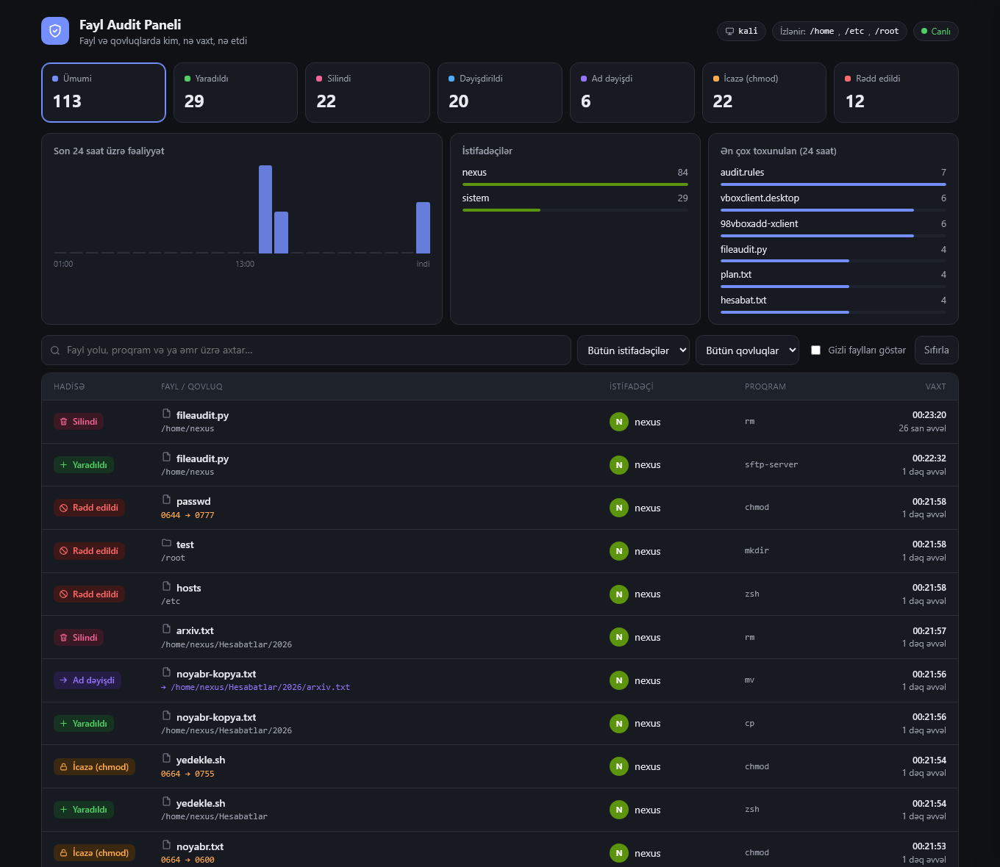
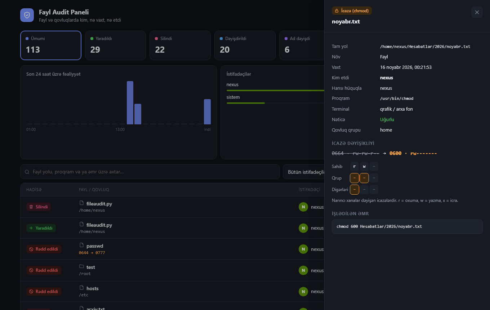
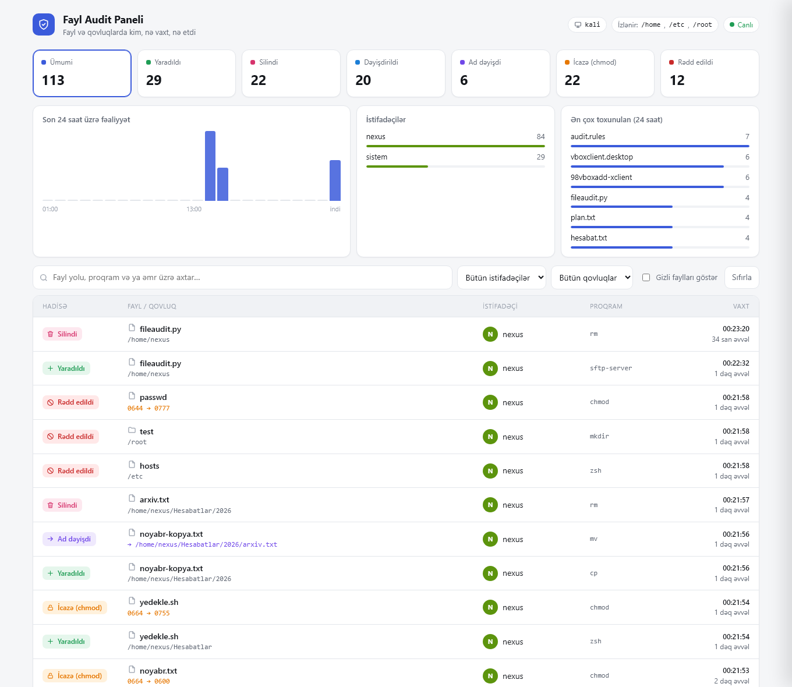

# AuditPulse

**Fayl Audit Paneli**

Linux-da fayl və qovluqlarla edilən əməliyyatları **kim, nə, nə vaxt və hansı proqramla** etdiyini göstərən veb panel. Xam log mətni əvəzinə hər hadisəni səliqəli cədvəldə, rəngli etiketlərlə göstərir.



Hadisəyə klikləyəndə ətraflı məlumat açılır. `chmod` hadisələrində köhnə və yeni icazə, dəyişən r/w/x xanaları ilə birlikdə göstərilir:



<details>
<summary>Açıq tema</summary>



Panel kompüterin temasına (açıq və ya qaranlıq) avtomatik uyğunlaşır.
</details>

## Nələri göstərir?

| Hadisə | Nümunə |
|---|---|
| **Yaradıldı** | yeni fayl, qovluq və ya link |
| **Silindi** | fayl və ya qovluq silinməsi (`rm`, `rm -r`, `rmdir`) |
| **Dəyişdirildi** | faylın içinə yazılması |
| **Ad dəyişdi** | `mv kohne.txt yeni.txt` (köhnə və yeni ad görünür) |
| **İcazə (chmod)** | köhnə və yeni icazə, məsələn `0664 → 0640` (`rw-rw-r-- → rw-r-----`) |
| **Sahib (chown)** | köhnə və yeni sahib, məsələn `ali:ali → root:ali` |
| **Rədd edildi** | icazəsi olmayan istifadəçinin cəhdi (məsələn `/etc/shadow`-a yazmaq) |

Hər hadisədə bunlar da görünür:
- əməliyyatı edən istifadəçi;
- `sudo` istifadə olunubsa, bu da ayrıca qeyd olunur (məsələn "ali → root kimi");
- hansı proqramla edildiyi (`chmod`, `rm`, `nano`…);
- işlədilən tam əmr;
- dəqiq tarix və saat.

Saytda bunlar da var:
- hadisə sayları olan kartlar;
- son 24 saatın qrafiki;
- ən aktiv istifadəçilər və ən çox dəyişdirilən fayllar;
- axtarış və filtrlər;
- avtomatik yenilənmə: yeni hadisə 2–3 saniyə ərzində siyahıya düşür.

Susmaya görə bu qovluqlar izlənir: **`/home`**, **`/etc`**, **`/root`**.

---

## Tələblər

- **Əməliyyat sistemi:** Kali Linux, Debian və ya Ubuntu (64-bit)
- **İnternet:** quraşdırma zamanı lazımdır (`auditd` paketini yükləmək üçün)
- **İstifadəçi:** `sudo` icazəsi olan istifadəçi
- **Python 3:** Kali-də hazır gəlir, əlavə Python paketi lazım deyil

Kali virtual maşında (VirtualBox, VMware) işləyirsə, heç bir əlavə ayar lazım deyil.

---

## Quraşdırma (addım-addım)

### 1-ci addım: Terminalı açın

Kali-də masaüstündə sağ klik → **Open Terminal Here** seçin, ya da `Ctrl + Alt + T` basın.

### 2-ci addım: Sistemi yeniləyin və `git` quraşdırın

```bash
sudo apt update
```

```bash
sudo apt install -y git
```

`sudo` parol soruşacaq. Öz parolunuzu yazıb Enter basın. Parol yazılarkən ekranda görünmür, bu normaldır.

### 3-cü addım: Layihəni yükləyin

```bash
git clone https://github.com/mikayilmovsumzada/AuditPulse.git
```

Bu əmr olduğunuz yerdə `AuditPulse` adlı qovluq yaradacaq.

### 4-cü addım: Layihə qovluğuna keçin

```bash
cd AuditPulse
```

### 5-ci addım: Quraşdırıcını işlədin

```bash
sudo bash install.sh
```

Quraşdırıcı bu işləri özü görür:
1. `auditd` (Linux audit sistemi) quraşdırılır və işə salınır.
2. Hansı qovluqların izlənəcəyini bildirən audit qaydaları yüklənir.
3. Proqram `/opt/fileaudit` qovluğuna köçürülür.
4. Panel sistem xidməti kimi işə salınır. Kompüter yenidən başlayanda da özü işə düşür.

Hər şey qaydasındadırsa, sonda bu yazını görəcəksiniz:

```
Hazırdır! Brauzerdə açın:  http://127.0.0.1:8088
İzlənən qovluqlar: /home /etc /root
```

### 6-cı addım: Paneli brauzerdə açın

Kali-də **Firefox**-u açın və ünvan sətrinə bunu yazın:

```
http://127.0.0.1:8088
```

Səhifəni əlfəcinlərə əlavə etmək rahat olar: `Ctrl + D`.

### 7-ci addım: Yoxlayın

Terminalda bu əmrləri bir-bir işlədin:

```bash
touch ~/test.txt
```

```bash
chmod 755 ~/test.txt
```

```bash
mv ~/test.txt ~/yoxlama.txt
```

```bash
rm ~/yoxlama.txt
```

Panelə baxın. Bir neçə saniyə ərzində siyahıda bu sətirlər görünməlidir: **Yaradıldı**, **İcazə (chmod)**, **Ad dəyişdi**, **Silindi**.

Bu sətirlər görünürsə, quraşdırma uğurla bitib.

---

## Paneldən istifadə

- **Kartlar** (yuxarıda): bir karta klikləsəniz, siyahıda yalnız həmin növ hadisələr qalır. Yenidən klikləsəniz, filtr ləğv olunur.
- **Axtarış:** fayl adı, yol, proqram və ya əmr yazın.
- **İstifadəçi / qovluq filtrləri:** yalnız bir istifadəçinin və ya bir qovluğun hadisələrinə baxmaq üçün.
- **Hadisəyə klik:** sağda ətraflı məlumat açılır: tam yol, vaxt, kim etdi, hansı hüquqla, proqram və işlədilən əmr. `chmod` hadisələrində sahib, qrup və digərləri üçün r/w/x cədvəli göstərilir, dəyişən icazələr narıncı rənglə seçilir.
- **"Gizli faylları göstər":** proqramlar `.cache`, `.config` kimi gizli qovluqlarda daim fayl yazır. Siyahı dolmasın deyə bu fayllar susmaya görə gizlədilir. Bu seçimi açanda onlar da görünür.
- **Sıfırla:** bütün filtrləri təmizləyir.

---

## Gündəlik idarəetmə

| Nə etmək istəyirsiniz | Əmr |
|---|---|
| Panel işləyirmi? | `systemctl status fileaudit` |
| Başlatmaq | `sudo systemctl start fileaudit` |
| Dayandırmaq | `sudo systemctl stop fileaudit` |
| Yenidən başlatmaq | `sudo systemctl restart fileaudit` |
| Açılışda avtomatik başlamasın | `sudo systemctl disable fileaudit` |
| Açılışda yenə avtomatik başlasın | `sudo systemctl enable fileaudit` |
| Bütün köhnə hadisələri silmək | `sudo systemctl stop fileaudit && sudo rm -f /var/lib/fileaudit/events.db* && sudo systemctl start fileaudit` |

`systemctl status` çıxışından qayıtmaq üçün `q` basın.

---

## Ayarlar

### Başqa qovluğu izləmək

1. Layihə qovluğunda `fileaudit.rules` faylını açın:
   ```bash
   nano fileaudit.rules
   ```
2. Digər `-w` sətirlərinin yanına yeni sətir əlavə edin. Məsələn, `/var/www` üçün:
   ```
   -w /var/www -p wa -k fa_www
   ```
   - `-w`: izlənəcək qovluq;
   - `-p wa`: yazma (`w`) və atribut dəyişiklikləri (`a`, yəni chmod və chown);
   - `-k`: qeyd adı. Mütləq **`fa_`** ilə başlamalıdır, yoxsa panel bu hadisəni görməyəcək.
3. Yadda saxlayın (`Ctrl + O`, Enter) və çıxın (`Ctrl + X`).
4. Quraşdırıcını yenidən işlədin:
   ```bash
   sudo bash install.sh
   ```

Qovluğu izləmədən çıxarmaq üçün də eyni yolla həmin sətri silin və `install.sh` faylını yenidən işlədin.

> **Diqqət:** bütün sistemi (`/`) izləməyin. Hər saniyə minlərlə hadisə yaranar, həm panel, həm də sistem yavaşlayar.

### Paneli şəbəkədən açmaq

Susmaya görə panel yalnız həmin kompüterdə açılır. Şəbəkədəki başqa kompüterdən açmaq üçün:

1. Xidmət faylını açın:
   ```bash
   sudo nano /etc/systemd/system/fileaudit.service
   ```
2. `FA_HOST=127.0.0.1` dəyərini `FA_HOST=0.0.0.0` ilə əvəz edin, yadda saxlayıb çıxın.
3. Xidməti yenidən başladın:
   ```bash
   sudo systemctl daemon-reload && sudo systemctl restart fileaudit
   ```
4. Kali-nin IP ünvanını öyrənin:
   ```bash
   ip -4 addr show | grep inet
   ```
5. Başqa kompüterdə brauzerə `http://KALI_IP:8088` yazın.

> **Diqqət:** panelin giriş parolu yoxdur. Şəbəkədəki hər kəs hadisələri görə bilər. Bunu yalnız etibarlı şəbəkədə edin.

### Portu dəyişmək

`/etc/systemd/system/fileaudit.service` faylında `FA_PORT=8088` dəyərini dəyişin, sonra xidməti yenidən başladın (yuxarıdakı 3-cü addım).

---

## Silmək

Layihə qovluğunda (`cd AuditPulse`) işlədin:

```bash
sudo bash uninstall.sh
```

Bu əmr proqramı, xidməti və audit qaydalarını silir. Toplanmış hadisələri də silmək üçün:

```bash
sudo bash uninstall.sh --hamisi
```

`auditd` sistemdə qalır, çünki digər proqramlar da ondan istifadə edə bilər.

---

## Problemlər və həlləri

**Brauzerdə "Unable to connect" / "Bağlantı qurula bilmədi" yazılır**

Panel işləmir. Vəziyyətini yoxlayın:
```bash
systemctl status fileaudit
```
`inactive` və ya `failed` yazılıbsa, başladın:
```bash
sudo systemctl start fileaudit
```
Yenə başlamırsa, səbəbə baxın:
```bash
journalctl -u fileaudit -n 30
```

**Panel açılır, amma hadisə görünmür**

1. `auditd` işləyirmi, yoxlayın:
   ```bash
   systemctl status auditd
   ```
2. Audit qaydaları yüklənibmi, yoxlayın:
   ```bash
   sudo auditctl -l
   ```
   Siyahıda `-w /home -p wa -k fa_home` kimi sətirlər olmalıdır. Yoxdursa, `sudo bash install.sh` əmrini yenidən işlədin.
3. Gizli qovluqda (adı nöqtə ilə başlayan) iş görmüsünüzsə, **"Gizli faylları göstər"** seçimini açın.

**`install.sh` "Fayl tapılmadı" deyir**

`install.sh` faylını layihə qovluğunun içində işlətmək lazımdır. Əvvəlcə `cd AuditPulse` yazın.

**`apt` xəta verir**

İnternet bağlantınızı yoxlayın və `sudo apt update` əmrini yenidən işlədin.

**İcazəsiz cəhddə fayl adı əvəzinə `/etc/…` görünür**

Bu normaldır. İcazəsiz fayl yaratma cəhdində Linux kernel faylın adını yazmır, yalnız qovluğu yazır. Panel adı işlədilən əmrdən tapmağa çalışır. Tapa bilməsə, yalnız qovluq göstərilir.

---

## Necə işləyir?

```
Kernel  →  auditd  →  audit.log  →  Kolektor (Python)  →  SQLite baza  →  Veb sayt
```

1. Linux kernel izlənən qovluqlardakı hər fayl əməliyyatını görür.
2. `auditd` bu əməliyyatları `/var/log/audit/audit.log` faylına yazır. Bu yazılar xam və oxunması çətin sətirlərdir.
3. `fileaudit.py` faylındakı kolektor bu logu canlı oxuyur. Bir əməliyyata aid bir neçə sətri birləşdirir, hadisənin növünü müəyyən edir, istifadəçi ID-lərini adlara, icazələri oxunaqlı formaya, əmrləri isə normal mətnə çevirir.
4. Hazır hadisələr SQLite bazasında saxlanır (ən çoxu 200 000 hadisə).
5. Həmin proqramdakı kiçik veb server bu məlumatı `127.0.0.1:8088` ünvanında göstərir.

Proqram yalnız Python-un standart kitabxanasından istifadə edir. `pip` ilə heç nə quraşdırmaq lazım deyil.

### Fayllar harada yerləşir?

| Nə | Yeri |
|---|---|
| Proqram (kolektor + veb server) | `/opt/fileaudit/fileaudit.py` |
| Veb səhifə | `/opt/fileaudit/web/index.html` |
| Audit qaydaları | `/etc/audit/rules.d/fileaudit.rules` |
| Hadisə bazası | `/var/lib/fileaudit/events.db` |
| Sistem xidməti | `/etc/systemd/system/fileaudit.service` |
| Xam audit logu | `/var/log/audit/audit.log` |

### Layihənin faylları

| Fayl | Nə edir |
|---|---|
| `install.sh` | Hər şeyi bir əmrlə quraşdırır |
| `uninstall.sh` | Hər şeyi silir |
| `fileaudit.py` | Kolektor və veb server |
| `web/index.html` | Panelin interfeysi |
| `fileaudit.rules` | Hansı qovluqların izlənəcəyi |
| `fileaudit.service` | Sistem xidmətinin ayarları |
